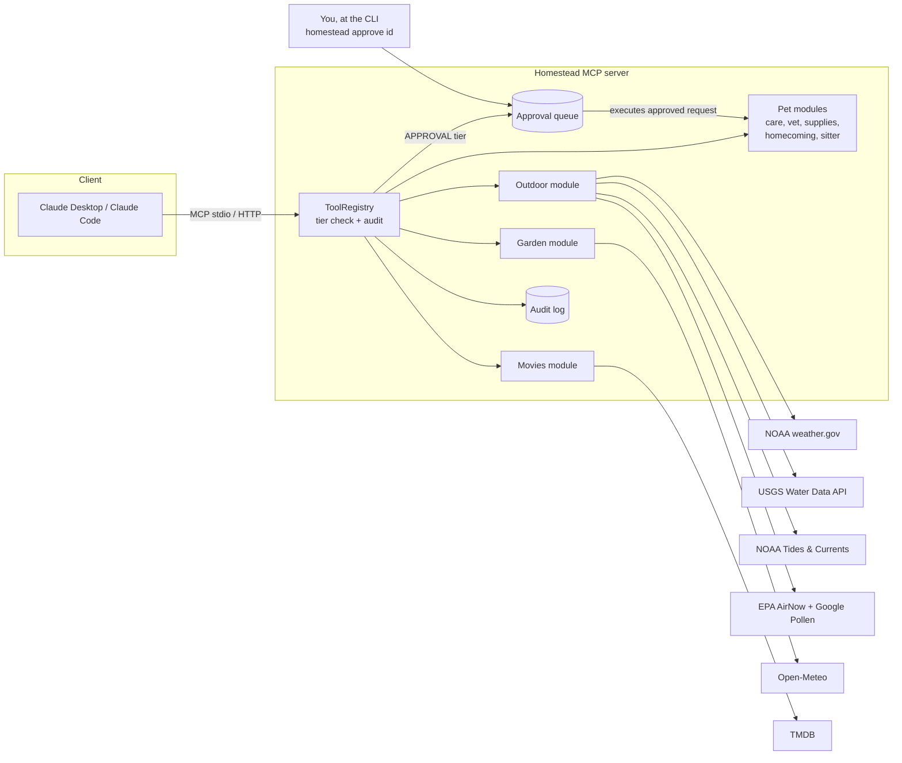

# Homestead MCP

[](https://github.com/alammers83/homestead-mcp/actions/workflows/ci.yml)

A personal household-ops [MCP](https://modelcontextprotocol.io) server that lets an AI assistant help run a home: deciding whether conditions are right for a kayak trip or a dog walk (weather, river, tides, air quality, daylight, and how hot the pavement is for paws), tracking pet care, vaccines, weight and supplies, handing off to the pet sitter, planning the garden, and keeping a horror watchlist for October.

The interesting part isn't the features. It's the **guardrails**: every tool runs at an explicit permission tier, anything that reaches outside the system waits for a human, every call is audited, and the whole thing is managed like production infrastructure (config-as-code, policy that CI enforces, Terraform, keyless deploys).

```text
You:    Can I kayak tomorrow morning around 9?
Claude: CAUTION. Weather is fine (64°F, wind 6 mph, 10% rain), but the Potomac
        at Little Falls is elevated at 18,400 ft³/s (your caution line is 15,000).
You:    OK, skip it. Ask the sitter if she can do Saturday instead.
Claude: I've queued that message (request 3f9a1c2e). Nothing is sent until you
        run `homestead approve 3f9a1c2e`.
```

## Why it's built this way

Agentic tools are only as trustworthy as the boundaries around them. Homestead treats "what may the agent do on its own?" as a first-class, testable design decision:

| Tier | What it means | Tools |
|---|---|---|
| **READ** | No side effects. Runs freely. | Outdoor: `list_activities`, `check_conditions`, `river_level`, `air_quality`, `tides`, `daylight`, `suggest_trails`<br>Pets: `list_pets`, `care_status`, `vet_status`, `weight_history`, `supplies_status`, `homecoming_plan`, `sitter_packet`, `reminders`<br>Garden: `planting_calendar`, `water_today`<br>Movies: `search_movies`, `horror_picks`, `watchlist`<br>System: `list_pending_approvals`, `recent_activity` |
| **WRITE** | Local, reversible changes. Runs autonomously, always audited. | `log_care`, `record_vaccine`, `log_vet_visit`, `log_weight`, `record_stock`, `check_off_homecoming`, `log_watering`, `add_to_watchlist`, `mark_watched`, `remove_from_watchlist` |
| **APPROVAL** | Reaches outside the system. Queued; a human must approve. | `notify_sitter`, `send_sitter_packet`, `request_reorder` |

Rules the code enforces, each with tests:

- **Tiers are declared in code; config can only tighten them.** `policy: {log_care: approval}` works. `policy: {notify_sitter: read}` fails at startup and in CI. A config PR can't quietly grant more autonomy.
- **The agent has no approval path.** There is no `approve` tool. Approval happens only through the `homestead` CLI, run by a person. A test fails if anyone adds one.
- **Requests expire** after 24 hours and can't be approved twice.
- **Every tool call is audited** (agent and human actions alike) to an append-only JSONL log, with credential-looking fields redacted.
- **Expected errors reach the model; crashes don't.** Bad input becomes a readable `ToolError` the assistant can correct. Anything unexpected stays server-side.
- **New tools need a deliberate tier.** A test pins the full tool→tier inventory, so adding a tool forces the decision into code review.
- **When data is missing, it says so.** If the river gauge or AirNow is unreachable or stale, the verdict degrades to CAUTION rather than a false GO.
- **OAuth admits one allowlisted Google account.** Clients may only register Claude's callback or a localhost redirect. Codes are single-use and need PKCE. Access tokens last an hour and refresh tokens rotate. Only token hashes are stored, and removing an email cuts off its tokens immediately.
- **API keys stay out of URLs and logs where possible.** TMDB's token goes in a header. AirNow and Google take keys as query parameters, so HTTP errors drop the query string before the message reaches the model or the audit log.

## Architecture



**Data sources.** No key needed:
- the NOAA National Weather Service hourly forecast
- the USGS Water Data API (`api.waterdata.usgs.gov`), the modern OGC API that replaces the legacy `waterservices.usgs.gov`, which USGS is retiring in early 2027
- NOAA CO-OPS tide and current predictions
- Open-Meteo daily rain and evapotranspiration for the garden (free for non-commercial use)
- sunrise, sunset and the pavement-temperature estimate, computed locally

Optional, each with a free key (the feature is skipped without one):
- EPA AirNow for air quality: `HOMESTEAD_AIRNOW_API_KEY`
- the Google Pollen API for pollen (AirNow has no pollen data): `HOMESTEAD_POLLEN_API_KEY`
- TMDB for movies: `HOMESTEAD_TMDB_TOKEN`, the API Read Access Token. *This product uses the TMDB API but is not endorsed or certified by TMDB.* Streaming availability comes from JustWatch via TMDB.

The pavement temperature is a rule-of-thumb estimate: air temperature plus up to 60°F, scaled by sun height and cloud cover. Trails come from your config, because there's no good free trails API.

**Production shape on GCP** (`infra/terraform`):
- Cloud Run (gen2), max 1 instance. Two ways in:
  - **IAM-gated** (default): no public invoker; you connect through `gcloud run services proxy`.
  - **OAuth** (optional, for Claude's web, desktop and phone apps): the server runs its own OAuth authorization server, with sign-in delegated to Google and an email allowlist. See [Connecting Claude's apps](#connecting-claudes-apps-oauth).
- Household config stored in **Secret Manager** and mounted as a file; it never touches git or the image
- State (audit log, approvals, care log) on a **versioned, private GCS bucket** mounted into the container
- Dedicated runtime service account with only bucket and secret access
- GitHub Actions deploys through **Workload Identity Federation**, restricted to this repo's `main` branch. No service-account keys exist.
- Artifact Registry with image cleanup policies

**CI** (`.github/workflows`): ruff, the test suite on Python 3.12 and 3.13, a check that the real config is never committed, `terraform fmt`/`validate`, and a Docker build. Deploys run only after CI passes on `main`. Dependabot keeps actions, pip, Docker, and Terraform current.

## Quick start (local)

```bash
python -m venv .venv && source .venv/bin/activate
pip install -e ".[dev]"
pytest                                  # 127 tests, no network needed

cp config/household.example.yaml config/household.yaml   # git-ignored; make it yours
export HOMESTEAD_USER_AGENT="homestead-mcp (github.com/alammers83/homestead-mcp)"  # NOAA asks clients to identify themselves
```

**Claude Code:**
```bash
claude mcp add homestead \
  -e HOMESTEAD_CONFIG="$PWD/config/household.yaml" \
  -e HOMESTEAD_STATE_DIR="$PWD/.state" \
  -- "$PWD/.venv/bin/homestead" serve
```

**Claude Desktop** (`claude_desktop_config.json`):
```json
{
  "mcpServers": {
    "homestead": {
      "command": "/absolute/path/to/homestead-mcp/.venv/bin/homestead",
      "args": ["serve"],
      "env": {
        "HOMESTEAD_CONFIG": "/absolute/path/to/homestead-mcp/config/household.yaml",
        "HOMESTEAD_STATE_DIR": "/absolute/path/to/homestead-mcp/.state"
      }
    }
  }
}
```

**Approving things:**
```bash
homestead approvals            # what's waiting
homestead approve 3f9a1c2e     # run it
homestead deny 3f9a1c2e --reason "already texted her"
homestead audit -n 20          # what happened, and who did it
```

## Deploying to GCP

```bash
cd infra/terraform
cp terraform.tfvars.example terraform.tfvars   # set project, repo, your account
terraform init

# 1. Create the config secret, then upload your real config as its first version
terraform apply -target=google_secret_manager_secret.household_config
gcloud secrets versions add homestead-household-config --data-file=../../config/household.yaml

# 2. Everything else (first revision runs a placeholder image)
terraform apply
```

**Optional API keys** (air quality, pollen, movies). Each has its own secret. Add a version, then list it in `enabled_api_keys` in `terraform.tfvars` and run `terraform apply` again:
```bash
printf %s "$AIRNOW_KEY" | gcloud secrets versions add homestead-airnow-key --data-file=-
printf %s "$POLLEN_KEY" | gcloud secrets versions add homestead-pollen-key --data-file=-
printf %s "$TMDB_TOKEN" | gcloud secrets versions add homestead-tmdb-key --data-file=-
```

After editing your real `household.yaml`, upload it as a new secret version with the same `gcloud secrets versions add homestead-household-config` command. New Cloud Run instances read the latest version.

Then in GitHub → Settings → Secrets and variables → Actions → **Variables**, add `GCP_REGION`, plus `IMAGE_REPO`, `WIF_PROVIDER`, and `DEPLOYER_SA` from `terraform output`. Create a `production` environment (add yourself as a required reviewer if you want a manual gate). The next green CI run on `main` deploys.

To connect a client to the private service:
```bash
gcloud run services proxy homestead --region us-east4 --port 8080
claude mcp add --transport http homestead http://localhost:8080/mcp
```

## Connecting Claude's apps (OAuth)

Claude's custom connectors (claude.ai, the desktop app, and the iPhone and Android apps) connect from Anthropic's servers, so they can't use the gcloud proxy. Turning on OAuth lets them in. The service opens to the internet, and every MCP request must carry a token that only your Google account can get.

> **Deploy the OAuth-capable code first.** Without it, step 4 would make the old, unauthenticated server public.

1. **Google OAuth client.** In Google Cloud console → *Google Auth Platform*:
   - *Branding*: app name "Homestead" and your email.
   - *Audience*: **External**, publishing status **Testing**, and add your Gmail as a test user. Only test users can sign in, which is a second lock.
   - *Clients* → *Create client* → **Web application**. Add the authorized redirect URI `https://<your service URL>/oauth/google/callback` (`terraform output oauth_redirect_uri` prints it once `public_url` is set). Copy the client ID and secret.
2. **Store the client secret.** The `homestead-google-oauth-key` secret exists after any `terraform apply` on this version:
   ```bash
   printf %s "$GOOGLE_CLIENT_SECRET" | gcloud secrets versions add homestead-google-oauth-key --data-file=-
   ```
3. **Settings** in `terraform.tfvars`:
   ```hcl
   public_url             = "https://homestead-xxxxxxxxxx-uk.a.run.app"   # terraform output service_url
   google_oauth_client_id = "1234-abc.apps.googleusercontent.com"
   allowed_emails         = ["you@gmail.com"]
   enabled_api_keys       = ["google-oauth"]   # plus airnow, tmdb, ... if you use them
   ```
4. `terraform apply`. The new revision with OAuth settings rolls out first, then the public invoker is added.
5. **Add the connector.** In claude.ai, go to *Settings → Connectors → Add custom connector*, enter `https://<your service URL>/mcp`, and sign in with Google. It then shows up in the phone app's connectors too.
6. **Claude Code** connects directly; the proxy isn't needed:
   ```bash
   claude mcp add --transport http homestead https://<your service URL>/mcp
   ```
   In Claude Desktop, use the claude.ai connector and remove any `mcp-remote` entry from `claude_desktop_config.json`.

To turn it off, clear `public_url` and apply. The public invoker goes away, and the service is IAM-only again.

Approvals still happen only at the CLI, so from your phone you can queue a sitter message or a reorder, but not approve it.

To approve requests made against the cloud deployment, mount the state bucket locally (for example with `gcsfuse`) and point `HOMESTEAD_STATE_DIR` at it.

## Privacy

This repo is public, so everything in it is **fictional sample data**. Real details live in a git-ignored `household.yaml` locally and in Secret Manager in the cloud. CI fails if the real file is ever committed. Weather is checked for a configured public location (a park or trailhead), not a home address.

## Roadmap

- [ ] Approval from my phone: a Slack message with Approve/Deny buttons, verified by signed request
- [x] Garden module: planting calendar and "water today?" from recent rainfall
- [x] Horror watchlist module (TMDB) for October
- [x] Air quality, pollen, tides, daylight, paw-safe pavement, and trail suggestions
- [x] Vet records, weight, supplies, new-dog homecoming plan, sitter handoff packet
- [x] OAuth in front of the HTTP transport for clients that can't use the gcloud proxy
- [ ] Eval suite: scripted conversations checking that the model picks the right tool and relays the request ID for approval-tier tools

## Project layout

```
src/homestead/
  policy.py        tiers and the only-tighten rule
  server.py        ToolRegistry: every tool goes through tier check + audit
  approvals.py     approval queue (create from MCP; decide from CLI only)
  audit.py         append-only JSONL with redaction
  auth.py          OAuth server for the HTTP transport, Google sign-in, email allowlist
  config.py        typed, validated YAML config
  store.py         append-only JSONL records in the state directory
  dates.py         "today" / "tomorrow" / YYYY-MM-DD parsing
  modules/
    outdoor.py     weather, river, air, sun, paws -> GO / CAUTION / NO_GO
    solar.py       sunrise/sunset and sun height (local math), pavement estimate
    airquality.py  EPA AirNow + Google Pollen
    tides.py       NOAA CO-OPS tides and currents
    trails.py      shade- and dog-aware trail ranking
    pack.py        care schedule, care log, sitter messages
    vet.py         vaccines and due dates, vet visits, weight trends
    supplies.py    food and med inventory; approval-gated reorders
    homecoming.py  new-dog gear checklist and introduction plan
    sitter.py      sitter handoff packet and household reminders
    garden.py      planting calendar and "water today?" (Open-Meteo)
    movies.py      TMDB horror picks and watchlist
tests/             guardrail, decision-logic, and end-to-end MCP tests
infra/terraform/   Cloud Run, GCS, Secret Manager, WIF, Artifact Registry
```

## License

MIT
