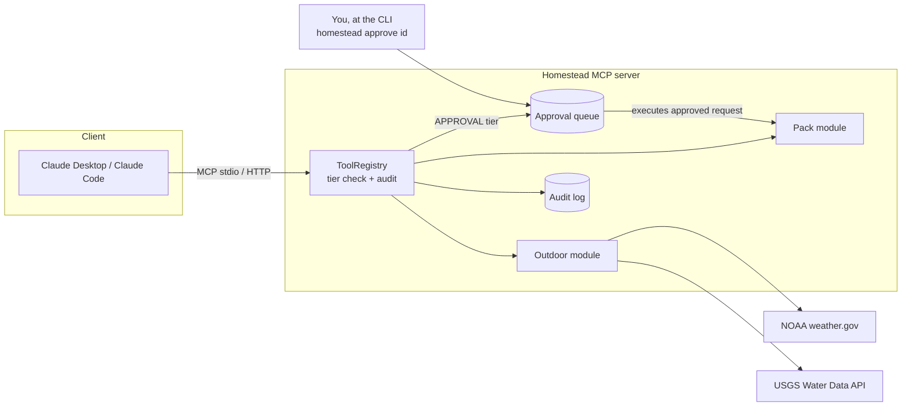

# Homestead MCP

[](https://github.com/alammers83/homestead-mcp/actions/workflows/ci.yml)

A personal household-ops [MCP](https://modelcontextprotocol.io) server that lets an AI assistant help run a home: deciding whether conditions are right for a kayak trip or a dog walk, tracking pet care, and messaging the pet sitter.

The interesting part isn't the features. It's the **guardrails**: every tool runs at an explicit permission tier, anything that reaches outside the system waits for a human, every call is audited, and the whole thing is managed like production infrastructure (config-as-code, policy that CI enforces, Terraform, keyless deploys).

```text
You:    Can I kayak tomorrow morning around 9?
Claude: CAUTION. Weather is fine (64°F, wind 6 mph, 10% rain), but the Potomac
        at Little Falls is elevated at 18,400 ft³/s (your caution line is 15,000).
You:    OK, skip it. Ask the sitter if she can do Saturday instead.
Claude: I've queued that message (request 3f9a1c2e). Nothing is sent until you
        run `homestead approve 3f9a1c2e`.
```

## Why it's built this way

Agentic tools are only as trustworthy as the boundaries around them. Homestead treats "what may the agent do on its own?" as a first-class, testable design decision:

| Tier | What it means | Tools |
|---|---|---|
| **READ** | No side effects. Runs freely. | `list_activities`, `check_conditions`, `river_level`, `list_pets`, `care_status`, `list_pending_approvals`, `recent_activity` |
| **WRITE** | Local, reversible changes. Runs autonomously, always audited. | `log_care` |
| **APPROVAL** | Reaches outside the system. Queued; a human must approve. | `notify_sitter` |

Rules the code enforces, each with tests:

- **Tiers are declared in code; config can only tighten them.** `policy: {log_care: approval}` works. `policy: {notify_sitter: read}` fails at startup and in CI. A config PR can't quietly grant more autonomy.
- **The agent has no approval path.** There is no `approve` tool. Approval happens only through the `homestead` CLI, run by a person. A test fails if anyone adds one.
- **Requests expire** after 24 hours and can't be approved twice.
- **Every tool call is audited** (agent and human actions alike) to an append-only JSONL log, with credential-looking fields redacted.
- **Expected errors reach the model; crashes don't.** Bad input becomes a readable `ToolError` the assistant can correct. Anything unexpected stays server-side.
- **New tools need a deliberate tier.** A test pins the full tool→tier inventory, so adding a tool forces the decision into code review.
- **When data is missing, it says so.** If the river gauge is unreachable or stale, the verdict degrades to CAUTION rather than a false GO.

## Architecture



**Data sources** (free, no keys): the NOAA National Weather Service hourly forecast and the USGS Water Data API (`api.waterdata.usgs.gov`), the modern OGC API that replaces the legacy `waterservices.usgs.gov`, which USGS is retiring in early 2027.

**Production shape on GCP** (`infra/terraform`):
- Cloud Run (gen2), **IAM-gated** with no public invoker, max 1 instance
- Household config stored in **Secret Manager** and mounted as a file; it never touches git or the image
- State (audit log, approvals, care log) on a **versioned, private GCS bucket** mounted into the container
- Dedicated runtime service account with only bucket and secret access
- GitHub Actions deploys through **Workload Identity Federation**, restricted to this repo's `main` branch. No service-account keys exist.
- Artifact Registry with image cleanup policies

**CI** (`.github/workflows`): ruff, the test suite on Python 3.12 and 3.13, a check that the real config is never committed, `terraform fmt`/`validate`, and a Docker build. Deploys run only after CI passes on `main`. Dependabot keeps actions, pip, Docker, and Terraform current.

## Quick start (local)

```bash
python -m venv .venv && source .venv/bin/activate
pip install -e ".[dev]"
pytest                                  # 42 tests, no network needed

cp config/household.example.yaml config/household.yaml   # git-ignored; make it yours
export HOMESTEAD_USER_AGENT="homestead-mcp (github.com/alammers83/homestead-mcp)"  # NOAA asks clients to identify themselves
```

**Claude Code:**
```bash
claude mcp add homestead \
  -e HOMESTEAD_CONFIG="$PWD/config/household.yaml" \
  -e HOMESTEAD_STATE_DIR="$PWD/.state" \
  -- "$PWD/.venv/bin/homestead" serve
```

**Claude Desktop** (`claude_desktop_config.json`):
```json
{
  "mcpServers": {
    "homestead": {
      "command": "/absolute/path/to/homestead-mcp/.venv/bin/homestead",
      "args": ["serve"],
      "env": {
        "HOMESTEAD_CONFIG": "/absolute/path/to/homestead-mcp/config/household.yaml",
        "HOMESTEAD_STATE_DIR": "/absolute/path/to/homestead-mcp/.state"
      }
    }
  }
}
```

**Approving things:**
```bash
homestead approvals            # what's waiting
homestead approve 3f9a1c2e     # run it
homestead deny 3f9a1c2e --reason "already texted her"
homestead audit -n 20          # what happened, and who did it
```

## Deploying to GCP

```bash
cd infra/terraform
cp terraform.tfvars.example terraform.tfvars   # set project, repo, your account
terraform init

# 1. Create the config secret, then upload your real config as its first version
terraform apply -target=google_secret_manager_secret.household_config
gcloud secrets versions add homestead-household-config --data-file=../../config/household.yaml

# 2. Everything else (first revision runs a placeholder image)
terraform apply
```

Then in GitHub → Settings → Secrets and variables → Actions → **Variables**, add `GCP_REGION`, plus `IMAGE_REPO`, `WIF_PROVIDER`, and `DEPLOYER_SA` from `terraform output`. Create a `production` environment (add yourself as a required reviewer if you want a manual gate). The next green CI run on `main` deploys.

To connect a client to the private service:
```bash
gcloud run services proxy homestead --region us-east4 --port 8080
claude mcp add --transport http homestead http://localhost:8080/mcp
```

To approve requests made against the cloud deployment, mount the state bucket locally (for example with `gcsfuse`) and point `HOMESTEAD_STATE_DIR` at it.

## Privacy

This repo is public, so everything in it is **fictional sample data**. Real details live in a git-ignored `household.yaml` locally and in Secret Manager in the cloud. CI fails if the real file is ever committed. Weather is checked for a configured public location (a park or trailhead), not a home address.

## Roadmap

- [ ] Approval from my phone: a Slack message with Approve/Deny buttons, verified by signed request
- [ ] Garden module: planting calendar and "water today?" from recent rainfall
- [ ] Horror watchlist module (TMDB) for October
- [ ] OAuth in front of the HTTP transport for clients that can't use the gcloud proxy
- [ ] Eval suite: scripted conversations checking that the model picks the right tool and relays the request ID for approval-tier tools

## Project layout

```
src/homestead/
  policy.py        tiers and the only-tighten rule
  server.py        ToolRegistry: every tool goes through tier check + audit
  approvals.py     approval queue (create from MCP; decide from CLI only)
  audit.py         append-only JSONL with redaction
  config.py        typed, validated YAML config
  modules/
    outdoor.py     NOAA + USGS -> GO / CAUTION / NO_GO (pure decision function)
    pack.py        care schedule, care log, sitter messages
tests/             guardrail, decision-logic, and end-to-end MCP tests
infra/terraform/   Cloud Run, GCS, Secret Manager, WIF, Artifact Registry
```

## License

MIT
